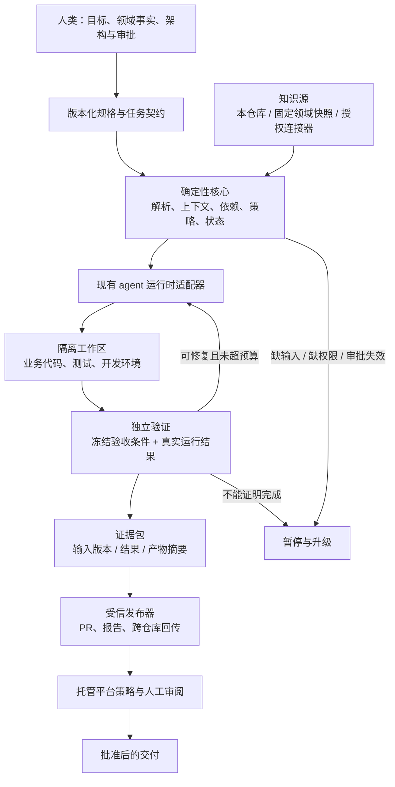

# 总体架构：Agent 可托管的工程底座

**提案状态：待评审；不是已实现能力。**

## 1. 产品定位

暂名 `agent-native-scaffold`。最终交付一个独立框架仓库，能够为新项目生成 agent-ready 的工程环境，也能逐步接入已有项目。

它的核心价值不是“生成更多代码”，而是使一个陌生 agent 可以在不依赖原开发者聊天记忆的情况下：

1. 定位任务所需的业务事实和工程约束；
2. 判断输入是否足够、审批是否有效、自己有没有权限；
3. 在隔离环境里修改代码、实现测试、运行应用并修复问题；
4. 留下可恢复状态和可复核证据；
5. 把结果交给正确的审阅者，而不是自行宣布一切完成。

**目标是有边界的自主开发，不是无限自治，也不是声称模型能理解所有隐含知识。**

### 非目标

- 不重新实现 LLM、代码编辑器或通用 coding-agent 工具循环。
- 不替代产品负责人、领域专家、架构师和风险责任人。
- 不要求所有项目采用完整 DDD、V-model、微服务或医疗监管流程。
- 不首发建设 Web 平台、向量数据库、图数据库、角色 agent 团队。
- 不自动修改生产数据、发布生产版本、迁移远端仓库或弱化组织策略。

## 2. 五类一等契约

| 契约 | 需要回答的问题 | 权威持有者 |
|---|---|---|
| 项目契约 | 我是谁、采用哪些方法与技术栈、依赖哪些版本、怎样运行 | 项目维护者 |
| 知识契约 | 事实、规范、假设、提案分别在哪里，来源和版本是什么 | 领域/规格所有者 |
| 任务契约 | 做什么、不做什么、允许修改哪里、完成的条件是什么 | 请求者与批准者 |
| 执行契约 | 使用哪个环境与 agent、权限和预算是多少、如何恢复 | 受信执行协调器 |
| 证据契约 | 哪个验收项被什么检查验证，针对哪个版本，谁批准了结果 | 验证器与托管平台 |

Markdown 负责可读的意图和解释；结构化字段负责机器判断；真实进程结果与平台记录负责证明。三者不能互相冒充。

## 3. 系统边界

确定性核心不负责“替模型思考业务”，而负责避免模型跳过流程。运行时适配器尽量薄：调用已有 agent，传入任务和工具限制，接收结果与检查点，不再包一层自主 LLM 去重新指挥每个文件修改。

## 4. 组成模块

| 模块 | 职责 | 明确不负责 |
|---|---|---|
| Bootstrap / Doctor | 校验身份、路径、依赖、工具链、权限能力和版本 | 猜测缺失配置或自动切换到不同仓库 |
| Context Builder | 根据任务解析权威资料、相关规则与依赖，生成最小上下文包 | 把所有仓库全文注入；让外部资料变成操作指令 |
| Artifact Index / Checker | 解析工件、限定 ID、引用关系、过期状态与影响范围 | 用 LLM 自由发挥替代结构校验 |
| Task / Run Coordinator | 校验前置条件、记录状态、控制重试、暂停和恢复 | 模拟企业角色组织；MVP 中跨机器分布式抢任务 |
| Agent Adapter | 对接一种经验证的 coding agent，保留原始退出状态和能力差异 | 声称所有 agent 原生支持相同记忆、审批或权限语义 |
| Verifier | 运行批准的检查集合、解析真实结果、检查候选变更范围 | 只相信 agent 的“测试已通过”叙述 |
| Publisher / Provider Adapter | Azure DevOps 或 GitHub 的 PR、审批查询、证据发布 | 把写权限令牌直接交给 worker |
| Profile / Stack Pack | 提供领域方法、工件映射、技术栈命令和架构规则 | 把 Device Registry 私有业务硬编码进核心 |

首版是一个 CLI 包中的清晰模块，不必将每个模块部署成服务。远端系统、原有 CI 和 agent 运行时提供现成能力。

## 5. 知识结构与唯一权威源

### 5.1 常驻入口要小

`AGENTS.md` 只承担导航：

- 项目的目标与边界；
- 读取 `agent.yaml` 和相应任务的位置；
- 常用命令的稳定入口；
- 不可越过的写入与审批边界；
- 如何报告阻塞及如何判断完成。

建议初始预算为约 100 行，而不是强制行业标准。具体规模通过冷启动任务评估调整。语言/框架细节放到作用域文档，活动步骤放到 skills，长参考资料按需读取。

### 5.2 同一信息不能有两个可编辑的“真相”

| 信息 | 权威源 | 允许存在的派生视图 |
|---|---|---|
| 需求、领域语义、AC | 明确拥有者的工件内容及结构化元数据 | 搜索索引、上下文包、矩阵 |
| 人工审批 | 托管平台或批准系统中与内容版本绑定的记录 | 本地只读缓存、审阅报告 |
| 代码现状 | 精确提交及工作区变更 | 静态分析索引、API 文档 |
| 测试执行结果 | 针对该候选版本的验证器/CI 记录 | 验证摘要、覆盖视图 |
| 运行进度 | 协调器的持久状态与事件记录 | task 看板、handoff 文档 |
| 规则及检查集合 | 受保护基线中的策略与版本锁 | agent 客户端适配文件 |
| 外部领域模型 | 固定仓库身份、commit、仓库内路径 | 只读本地快照 |

对新工件，优先采用 Markdown + 受 schema 约束的 frontmatter。对原有 DDD 工程，通过映射适配表格、目录和 `model.yaml`，不一开始重写全部内容。

新项目中的矩阵、实现摘要和索引默认生成。已有 `model.yaml` 中的领域定义与实现摘要必须先分清所有权，不能把整个文件都当作可覆盖的生成物。

### 5.3 外部知识的处理

外部 ADR/wiki、接口定义、工单内容采用两种方式之一：

- 经授权保存带来源与版本的摘要/快照；
- 通过只读连接器按需读取，并记录版本或内容摘要。

无法读取时标记 `unavailable`；不能用“没有找到”推断“没有约束”。来源里的命令、提示词、链接和用户文本均视为资料，不能自动获得更高权限。

## 6. 工件图，而不是强制填满一根链

核心只定义通用关系，如：

`derives_from`、`implements`、`verifies`、`constrains`、`depends_on`、`reports_on`。

DDD 方法包定义 REQ、CAP、UC、BR、INV、SR、US、ABB、VT 等种类及允许关系。标识同时包含仓库命名空间；多个 BC 的 `US-001` 不冲突。

注意两个区别：

- 一项只读 UC 未必需要凭空新增一个 invariant；所需链接取决于活动与方法包，不为通过覆盖率而编造业务规则。
- 只有用于任务调度的 `depends_on` 子图要求无环。追溯图可以包含双向查询、反馈和不同语义边，不把整个图误当 DAG。

引用应绑定工件身份、版本和必要的 AC 标识，而不只是在 Markdown 中出现一个字符串。

## 7. 方法、保证等级、技术栈分开

不使用一个含义模糊的 `profile` 同时控制架构、监管和自主权限。

| 配置维度 | 示例 | 决定什么 |
|---|---|---|
| Method | `basic`、`ddd-v-model` | 工件种类、推导关系、领域工作流 |
| Assurance | `standard`、`regulated` | 审批、风险追溯、留存与资格要求 |
| Stack | `dotnet-service` | 代码布局、运行命令、测试解析与架构规则 |
| Execution mode | `observe`、`assisted`、`managed` | 本次执行的写权限、隔离和交付方式 |

首版试点建议 `ddd-v-model + standard + dotnet-service + managed`；若产品实际属于受监管范围，assurance 必须由责任人确认后调整，不能因试点便利而默认降级。

选择 `basic` 不代表无需规范、验收和审批，只是不用完整 DDD 工件体系。切换方法或降低 assurance 不是 worker 可以自行执行的普通任务。

## 8. 托管执行与可信边界

### 8.1 默认交付到待审 PR

MVP 可自动：读取批准输入、拆分限定任务、修改代码、实现测试、运行验证、修复自身引入的问题、产生证据和发起待审 PR。

MVP 不自动：批准新业务事实、改变 BC 边界、批准风险接受、合并主干、执行生产迁移、部署生产、扩大权限或修改自身验收门。

这不是逐步询问每次文件修改。任务范围和执行权限批准后，范围内的开发闭环应连续运行。

### 8.2 不能只靠 prompt 保护 prompt

worker 不拥有审批、分支策略和发布令牌；有效策略从受保护基线加载，不从候选分支的新文件即时加载。

worker 可以提出修改规则的 PR，但该变更不能在当前任务中立即生效。可信验证器检查候选变更是否触及受保护规则、测试基线或验收条件。

本地 Git hook、agent 自我评审、`allowed-tools` 描述和 `reviewed-by` 文本都只是辅助，不是最终安全边界。

### 8.3 隔离不仅是新建文件夹

每个任务使用独立 worktree/容器环境、临时数据库、唯一端口和独立缓存输出。它不得覆盖其他任务的未提交改动，也不得访问生产凭据。

候选代码及测试都可能执行任意程序；验证作业同样需要隔离、受限网络、最小权限和资源限制。

如果当前运行环境无法提供 managed 模式需要的隔离，必须报告 `blocked`，或由用户显式选择 assisted 模式。不能悄悄降低保护后仍标为“安全托管”。

## 9. 状态、恢复与可观测性

MVP 使用单执行者的持久状态存储，例如本地 SQLite；不让多个 agent 直接写同一份任务 JSON。任务 Markdown 保存意图，不兼任并发协调锁。

记录：

- 任务、尝试、工作区与 runner 的标识；
- 输入、规则、工具链与候选代码的版本；
- 前置条件、状态迁移和失败分类；
- 执行命令、结果位置、资源消耗；
- 等待的审批、下一步和恢复前需要核验的条件。

每个重要边界写检查点。进程重启和新 agent 会话可以从同一状态恢复；跨机器接管要求先成功获取受信状态包，不声称仅靠 Git 日志就能恢复一切。

业务应用的日志采用结构化输出及 correlation ID。首个服务包提供 health/readiness、请求样本、数据库状态和测试报告入口；UI 验证由未来 Web 技术栈包提供，不给纯服务强加浏览器依赖。

## 10. 跨仓库治理

保留“领域仓库拥有事实，实现仓库拥有代码和实现证据”的分工。

BC 读取固定领域快照，并发布实现报告。领域侧收到报告后，可以生成 `model.yaml` 的实现摘要或独立摘要文件，但只能通过领域侧的授权工作流更新。

报告携带领域基线、实现提交、证据摘要和因果标识。仅更新报告不触发新的业务变更循环；消费者也不因为上游摘要新提交就自动追逐 HEAD。详见[执行契约](execution-contracts.md)。

## 11. 首版技术选择建议

| 项目 | 建议 | 原因及边界 |
|---|---|---|
| 核心 CLI | Python 3.12+，Typer | 与现有工具经验接近；业务工程语言不受此限制 |
| 契约 | JSON Schema 作为公开定义，YAML/JSON 为载体 | 不手写第二套不一致的 Pydantic 权威 schema |
| 模板 | 可审阅的模板渲染，严格变量模式 | 未提供的变量报错；不遗留占位符 |
| 本地状态 | SQLite + 可导出的检查点 | 足够支撑单主运行；暂不做分布式平台 |
| 第一技术栈 | .NET 服务，兼容样本中的 `net10.0` | SDK 完整版本、镜像和依赖由实施时锁定，不照抄宽松版本 |
| 第一托管平台 | Azure DevOps adapter | 贴合现有工程；GitHub adapter 后续接入 |
| 第一 coding agent | 经组织批准且支持所需非交互能力的一种现有 CLI | 优先验证 Copilot CLI；不假定 GitHub cloud agent 能直接运行 Azure Repos 任务 |

这些是推荐而非已批准选型。实际运行时能力、许可、操作系统支持和发布渠道在 P0 明确。

## 12. 成功与失败的定义

成功不是“目录生成了”或“agent 说完成了”，而是一个新 agent 可以在受支持环境中，根据持久契约交付一个限定任务，并让独立机制证明它满足验收要求。

失败包括：事实不明确仍继续、错误基线下运行、测试未执行却通过、越界写入、审批过期仍复用、恢复导致重复副作用、修改检查器给自己放行。

这些失败模式都必须进入[验收计划](../plan/roadmap.md)，不能只出现在设计文档里。
