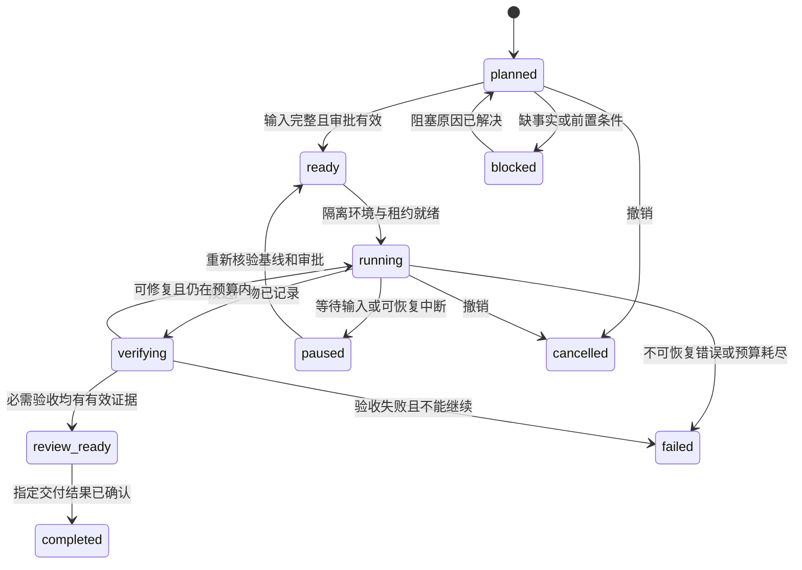

# 执行、审批与证据契约

本文件定义未来实现必须满足的行为。示例是设计草案，不是本轮已经生成的运行配置。

## 1. 一个完整任务的输入

不要把“实现设备注册”这样的自然语言单句直接作为无限执行许可。它应被收敛成可审阅的任务契约：

```yaml
schemaVersion: "1"
taskId: TASK-001
delivery: draft-pr
intent: Implement the approved registration slice.
specRefs:
  - repositoryId: sample-service
    artifactId: US-001
    revision: "<approved-content-digest>"
acceptanceRefs:
  - artifactId: US-001
    criterionId: AC-1
    revision: "<approved-content-digest>"
inputs:
  domain:
    repositoryId: sample-domain
    commit: "<full-commit-sha>"
    repositoryPath: domain-model/subdomains/sample/contexts/registry
allowedWrites:
  - src/
  - tests/
  - docs/runbooks/
protectedWrites:
  - agent.yaml
  - agent.lock.json
  - .agent/policies/
verification:
  requiredCommands: [build, unit, integration, contract, smoke]
dependencies: []
approvalRef: "<trusted-approval-record>"
budgetRef: "<approved-execution-budget>"
```

执行器还要核验受保护策略、只读挂载、实际 Git 基线和平台审批。示例中的 `allowedWrites` 不是绕过操作系统隔离的许可。

任务分解可以由 agent 提议，但不能因此扩大父任务范围。新增业务需求、跨 BC 变更和风险项必须生成单独提案，不能藏在实现计划中。

## 2. 三种状态分开管理

| 对象 | 表达什么 | 谁能变更 |
|---|---|---|
| 工件生命周期 | 内容是 draft、review-requested、approved 还是 superseded | 依据工件所有权与批准工作流 |
| 审批记录 | 谁在什么时间批准了哪个内容摘要、哪些动作 | 可信审批系统；worker 只读 |
| 任务运行状态 | 是否准备好、执行中、验证中、等待审阅、失败或暂停 | 协调器，根据实际事件变更 |

legacy adapter 将 `Backlog/Ready/In Progress/Done` 等业务状态映射到明确语义，但不自动把这些标签当成审批身份验证。

### 运行状态机



`completed` 的含义由 `delivery` 定义。若交付目标是 `draft-pr`，它只意味着证据齐全且待审 PR 已成功创建，不意味着已合并或已上线。变更的 `merged/released` 状态从远端事实另行获取。

审批在任意阶段失效时，禁止继续写入或发布，并进入受控暂停/阻塞。不能因为已经执行了一半就绕过门禁。

## 3. 有效审批的判定

审批记录至少绑定：

- 工件或任务 ID；
- 审阅内容的不可歧义摘要；
- 允许的执行范围、交付方式与策略版本；
- 有资格的审批者身份及来源系统；
- 生效时间、有效期或撤销状态。

MVP 可以采用“内容变化即重新审阅”的保守策略，不一开始实现复杂语义等价判断。摘要计算必须包括会影响行为的正文和元数据，排除单纯派生的运行状态字段，避免自引用。

下列内容均不足以单独放行：

- agent 在文件里写 `Approved`；
- `reviewed-by: 某人` 的 commit 文本；
- 父工件已经 Approved；
- 模型自评置信度很高；
- 测试全绿，但批准的验收集合已被更改。

审批 API 不可用时，只能使用符合有效期与撤销策略的受信缓存；不能把不可用解释成无需审批。离线模式可产出提案，但不能伪造合并权限。

## 4. 上下文包

任务启动时生成一份可再生的 context manifest：

| 内容 | 要求 |
|---|---|
| 当前目标 | intent、scope、non-goals、验收项 |
| 权威资料 | repositoryId、commit、path、artifactId、内容摘要 |
| 相关工程规则 | 与写集合和技术栈匹配的规则及版本 |
| 依赖与开放问题 | 前置任务、不可用来源、未决 BL、批准情况 |
| 运行入口 | 已批准命令标识、环境说明、诊断入口 |
| 结束条件 | 证据清单、交付目标、失败与升级条件 |

只做按任务的必要闭包，不把全部八个仓库都塞进上下文。索引丢失可重建；权威原件不可读则阻塞。

### 路径解析

每个外部来源分别声明：

```text
repository URL
repository commit
local mount root
repository-internal path
```

解析器规范化路径、检查存在性、校验 gitlink/lock 与实际版本，拒绝逃出授权根目录的相对路径和符号链接。不会根据“看起来像正确名字”选择另一个仓库。

## 5. 受托开发闭环

1. **Prepare**：核验基线和已有改动，准备隔离环境，执行最小基线检查。
2. **Plan**：列出待改范围、验收映射和依赖；重大范围变化等待批准。
3. **Implement**：worker 修改批准范围内的已有代码或新增代码，同时实现相应测试。
4. **Verify**：独立验证进程执行批准的命令，检查真实行为和候选变更。
5. **Repair**：对明确可修复的问题，在有限预算内继续；不得删测试、降低门禁或扩大需求来制造通过。
6. **Publish**：由受信发布器形成审阅摘要、证据链接和待审 PR。
7. **Respond / Resume**：收到相关评审意见后，以更新后的任务或审批继续；每次都验证新基线。

小变更允许轻量计划，但没有验收目标、执行证据和范围约束的任务不能进入 managed 模式。

## 6. 完成证据

### 6.1 证据清单

| 字段 | 用途 |
|---|---|
| `taskId/runId/attemptId` | 关联任务和执行尝试 |
| 输入及规则摘要 | 说明本次基于哪份意图、审批、工具和方法包 |
| 候选提交/内容摘要 | 防止复用其他提交的绿色结果 |
| 完整限定 AC 引用 | 防止不同 US、VT 中的 `AC-1` 混淆 |
| 实际测试标识 | 测试 runner 中可定位的 test ID，不只是文件名 |
| 命令、退出状态和报告 | 可复核执行了什么 |
| 通过、失败、跳过、未执行数量 | 零测试或未执行不得等同于成功 |
| 环境、工具链与依赖版本 | 便于复现与解释差异 |
| 原始结果位置及摘要 | CI artifact、日志、截图等；不把大日志塞进 Git |
| 发布与审批记录 | 远端操作的真实结果 |

`specification exists`、`test implemented`、`test executed`、`acceptance verified` 是四种不同事实。

### 6.2 防止自证完成

验证器从受保护基线读取检查器和冻结验收条件，不能直接采用候选分支削弱后的门禁。

新测试可以由 worker 编写，但它们必须与批准 AC 对应，并接受独立审阅/检查。关键回归样例由独立维护者维护；不能把“同一 agent 写功能再写一条必过测试”作为充分证据。

删除、跳过或显著削弱已有验收测试需要专门说明与审批。测试修复是合法任务，但不能以“修复 flaky”为名在当前任务中默认豁免。

### 6.3 证据有效期

候选代码、测试、验收条件、依赖锁或验证环境改变后，相关证据失效并重新执行。单纯生成审阅摘要不应强制重新跑业务测试；需要区分代码输入摘要和报告发布提交。

实际数据缺失时使用 `not-run`、`unknown`、`blocked`，绝不补一个 `pass`。

## 7. 失败与停止规则

| 情况 | 必须采取的行为 |
|---|---|
| 缺业务事实、相互矛盾的约束 | 记录具体问题，停止受影响任务；不编造答案 |
| 领域源或依赖版本不可读取 | 报告来源与版本，阻塞；不自动切到 HEAD |
| 预先存在的失败 | 记录基线，区分本次回归；无授权不顺便修全仓 |
| 必需测试未发现、未执行、结果不可解析 | 验收失败或阻塞；不能判绿 |
| 命令失败或超时 | 保留失败状态和日志；按明确的可重试类别处理 |
| 达到时间、token、费用或重试预算 | 写检查点并停止；费用未知时不得声称仍在费用上限内 |
| 候选变更触及受保护规则 | 单独走治理变更审批，不允许自解锁 |
| 并发修改或工作区脏状态冲突 | 停止受影响写入，保留双方内容，不强制覆盖 |
| 审批被撤销或输入变化 | 暂停，重新计算影响并要求有效审批 |
| 发布请求超时，结果不确定 | 先查询远端幂等键/PR 状态，再决定是否重试 |
| 不支持的 runner 能力 | 显式 unsupported/blocked，不静默降级 |

预算由任务或项目所有者批准。框架必须支持上限与日志，但本设计不凭空替用户选择模型账单限额。

## 8. 中断和恢复

检查点至少保存：输入版本、候选摘要、未提交补丁位置、已完成命令、已确认外部操作、下一步、失败原因和有效租约。

恢复顺序：

1. 加载受信状态，确认任务未取消且没有另一个活跃执行者。
2. 核验仓库身份、基线、工作区改动和策略版本。
3. 重新核验审批和不可变输入是否仍适用。
4. 验证已有证据是否匹配当前候选版本。
5. 查询状态不明的外部操作，避免重复创建 PR 或重复触发变更。
6. 从第一个尚未有效完成的阶段继续。

若工作区丢失或被人修改，先做恢复/冲突处理，不简单执行 `git reset`。新会话可以接管，但不能假装旧状态永远可靠。

MVP 单主协调；将来的多 worker 必须使用协调器的原子领取、超时租约和 compare-and-swap，而非让 agent 在共享 Markdown 里竞争任务。

## 9. 跨仓库实现报告

### 9.1 避免只读 submodule 写回

实施流程：

```text
领域仓库固定基线 D
  -> BC 任务读取 D
  -> 实现提交 I，针对 I 运行验证得到 E
  -> BC 生成 implementation-report(D, I, E)
  -> 发布器在独立领域工作区提出报告更新 PR
  -> 领域所有者批准后，生成相应摘要视图
```

报告表示“这个实现版本针对这个领域版本有这些证据”，不表示“当前所有领域 HEAD 都已经实现”。

### 9.2 幂等与循环控制

报告的关联标识包括源仓库、实现内容摘要、目标仓库和用途。重试先查询是否已有对应记录。

报告更新提交不算新的业务输入；不因 summary-only commit 再派生一次实现任务。新的领域事实变更才进入影响分析。

跨仓库没有一个原子的全局 Git 提交。必须呈现 `pending/accepted/rejected/stale` 的同步状态，并能对部分失败重试或撤销未接受提案，而不是宣称所有仓库已同时更新。

### 9.3 影响分析

比较被批准基线与新版本，按 typed references 找出受影响工件、任务、验证与消费者。先失效相关证据和审批，再提出变化计划。

图上结构关系用于候选集合；语义影响由专家或受审 agent 分析确认。程序能发现断链，不等于能自动证明业务变更无影响。

## 10. Skill 契约

每个 skill 需要说明触发条件、输入、输出、允许范围、前置检查、验证方式、停止规则和报告格式。

技能是“如何执行活动”的说明，不拥有审批权，也不覆盖更高层策略。metadata 用于发现，正文按需加载，长参考与脚本分开。

调用脚本仍经过权限与来源控制；不能仅因某个 `SKILL.md` 列出了脚本，就授予它任意网络或生产访问能力。

## 11. 对照参考样本的预期行为

以现有 US-001 作为研究样本，新框架应能：

- 精确选择其批准范围，不顺带实现明确延后的 OTP 或 Draft enrollment。
- 解析真实领域子模块路径，无法解析时报告配置错误。
- 识别 VT 规格、测试代码与 API 契约的版本/字段差异，提出修订而不是静默选择一种。
- 生成验收到测试的明确映射，不把局部同名 AC 混为同一项。
- 在没有针对候选版本的真实结果前，保持 `not-run` 或 `review_ready` 之前的状态。
- 向领域仓库提交实现摘要提案，而不是修改只读挂载里的领域模型。

这是后续试点的预期，不是本轮对现有业务工程的修改。
