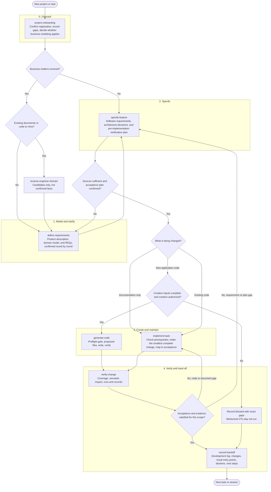

# Project flow from zero to one

This page is a derived view of the existing method documents. It is not a formal artifact, does not authorize any step, and records no results. The `SKILL.md` file for each step is authoritative.

## Overview

## Stages

| Stage | Method | Entry condition | Output | Stop or blocked condition |
| --- | --- | --- | --- | --- |
| 0. Onboard | [project-onboarding](../.github/skills/project-onboarding/SKILL.md) | Goal, scope, and authorization of the task; confirmed project materials | Confirmed registration fields, recorded gaps, applicability of business modeling | Unconfirmed fields stay unconfirmed; no guessed stage |
| 1. Model and clarify | [define-requirements](../.github/skills/define-requirements/SKILL.md) | Business matters apply | [Product description](../stakeholder-requirements/README.md#product), [domain model](../domain-model/README.md), REQs | Respondents or sources missing; open questions remain open |
| 1a. Mine existing material (optional) | [reverse-engineer-domain](../.github/skills/reverse-engineer-domain/SKILL.md) | Existing documents or code the user has authorized | Candidates with their sources | Candidates are never confirmed automatically |
| 2. Specify | [specify-feature](../.github/skills/specify-feature/SKILL.md) | Sources and requirements sufficient | [Software requirements](../software-requirements/README.md), [architecture](../architecture/README.md), [verification plan](../verification/README.md) | Insufficient sources send the work back to stage 1 |
| 3a. Create (gated) | [generate-code](../.github/skills/generate-code/SKILL.md) | Project, stack, location, commands, and creation permission all confirmed ([creation inputs](development.md#creation-inputs)) | Initial files that passed the preflight gate | Any missing input or conflicting non-empty target stops the write |
| 3b. Maintain | [implement-task](../.github/skills/implement-task/SKILL.md) | Task, acceptance criteria, and the actual directory | Smallest complete change, mapped to acceptance criteria | Missing prerequisites mark the task `blocked` |
| 4. Verify | [verify-change](../.github/skills/verify-change/SKILL.md) | Changes made and actual results available | Coverage and impact conclusions, run records kept separate | Unrun checks stay `not-run`; no pass is inferred |
| 5. Hand off | [record-handoff](../.github/skills/record-handoff/SKILL.md) | Any stopping point, including blocked work | [Development log](../_templates/items/development-log.md) and [logs directory](../logs/README.md) | Takeover rechecks the Git state and evidence first |

## Gates

- **Creation gate.** Code is created only after the user has chosen the project, stack, and location, authorized creation, and supplied the commands and working directories. Missing inputs make the task `blocked`; documentation work can continue. See [creation inputs](development.md#creation-inputs) and [project registration](development.md#project-registration).
- **Preflight gate.** [generate-code](../.github/skills/generate-code/SKILL.md) checks the directory, Git state, applicable rules, and every write path before writing anything.
- **Evidence gate.** [verify-change](../.github/skills/verify-change/SKILL.md) keeps coverage, impact, and run results separate. A `not-run` item is never recorded as a pass.

## Notes

- Documentation-only work skips stage 3a and follows the documentation branch of [implement-task](../.github/skills/implement-task/SKILL.md).
- Business modeling is applicable only when business matters are involved. Technical and documentation maintenance state that it does not apply.
- A new session or a takeover starts from [record-handoff](../.github/skills/record-handoff/SKILL.md#resume), not from chat history.
