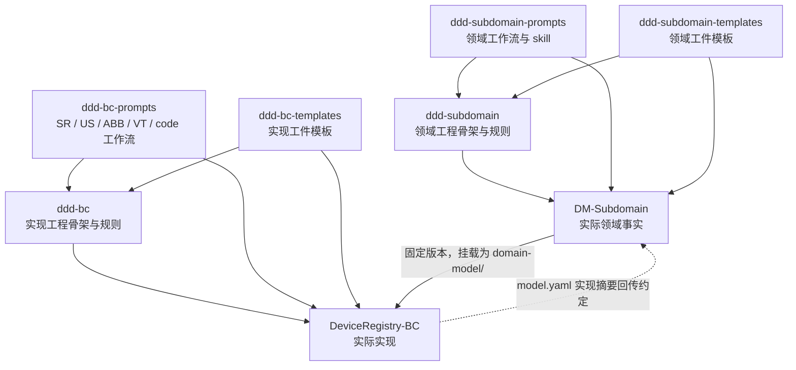

# 参考仓库研究解读

## 1. 总体判断

这套体系是 **领域事实驱动、V-model 追溯、工作流级 AI 辅助的工程框架**，不是简单的 CRUD 脚手架。它已经回答了“业务事实从哪里来”“不同工件归谁维护”“如何从领域推导实现”。

距离本次目标的主要差距是：**多数开发规则仍需要 agent 和人工正确解释，尚未形成一个可恢复、可强制执行、以真实运行证据判定完成的托管闭环。**

这个判断不否定已有工具：上游已经有 artifact validator、Git hook、fan-out pipeline，也有执行引擎路线图。应分别看待“已有局部自动化”和“端到端托管已经成立”。版本与证据见[来源登记](source-register.md)。

## 2. 八个仓库的关系



图中的“骨架 → 实例”表示结构和工作流上的关系，不表示本轮验证了完整 Git 祖先关系。prompts/templates 的消费版本也不一定是上游 HEAD。

### 三类职责被分开

| 层次 | 作用 | 价值 |
|---|---|---|
| 框架工程 | 目录、指南、作用域规则、工具、接入约定 | 给人和 agent 一个稳定工作场所 |
| Prompts / skills | 领域访谈、派生工件、评审、影响分析等活动 | 把活动变成有输入输出的工作流，而不是模糊角色 |
| Templates | 工件的字段、状态、引用和内容结构 | 让结果可比较、可索引、可校验 |

新框架应保留这种逻辑分层，但初期不必继续拆成六个物理依赖仓库。单仓统一发布更容易保证 schema、模板、skill 与校验器兼容。

## 3. 业务链条已经相当完整

### 上半个 V：先确定是否在解决正确的问题

`DM-Subdomain` 保存领域定义、术语、业务规则、bounded contexts、capabilities、use cases、invariants、stakeholder requirements 和 validation scenarios。

关键原则包括：

- 领域知识由专家提供；未知项进入 `BL-NNN`，不能由 agent 凭空补齐。
- 业务规则先于 invariant；产物首先是 Draft，确认与批准由人负责。
- 一个 subdomain 对应一个拥有明确所有权的领域仓库；实现代码不放在这里。
- `model.yaml` 为跨仓库桥接提供机器可读视图。

### 下半个 V：把已确定的意图落实为软件并验证

`DeviceRegistry-BC` 的主要链条是：

```text
领域 REQ / UC / INV
  -> 软件要求 SR
  -> 交付切片 US
  -> 架构 ABB 与验证规格 VT
  -> 实现代码和实际测试
```

ABB 与 VT 可以在 US 条件满足后并行，而不是强制“架构 agent 完成后才能给 QA agent”。这正是工作流优于角色表演的地方。

### 一个实际纵向样本

按 DeviceRegistry-BC 固定的领域版本 `a187ce9c...` 阅读：

| 环节 | 实际内容 | 证据 |
|---|---|---|
| REQ-001 | Common Device Onboarding，包含权限、身份、失败不能留下部分注册等业务验收要求 | E11 |
| UC-DR-001 | 已批准的注册流程；OTP、portal enrollment 等存在单独的未决边界 | E11 |
| SR-001 | 软件注册要求，引用 REQ、UC 和 invariant | E10 |
| US-001 | 已批准的交付切片，明确 OTP 和 Draft enrollment 不在此次范围 | E10 |
| ABB-001 | API、Domain、Persistence、Integration 等设计以及外部依赖 | E10 |
| VT-002 | 集成验证规格，包含持久化、Identity stub、事件与 Model 创建 | E10 |
| 代码 | `RegisterDeviceCommandHandler.cs` 有 UC/SR/US/VT 引用，并编排工厂、持久化与事件发布 | E12 |
| 测试 | `VT002_RegisterDeviceIntegrationTests.cs` 有实际 API、PostgreSQL 和事件断言 | E13 |

目录及矩阵中能看到 18 个 SR、15 个 US、22 个 VT 文档，也有 unit/integration/e2e 测试工程。`net10.0` 与 C# 14 来自实际工程文件，不是根据仓库名称推断。

**但有测试文件不等于已验证完成。** 本轮没有执行它们，也没有获取相应提交的可信 CI 结果。

## 4. 应继承的设计

| 已有优点 | 新仓库中的继承方式 |
|---|---|
| 领域先于代码，未知问题显式记录 | 上下文区分事实、假设和提案；未决问题可以阻塞任务 |
| 工作流级 prompts，而非角色串联 | skill 对应具体活动，声明输入、输出、修改范围和结束条件 |
| 上下游仓库所有权明确 | 只读领域快照 + 独立的实现报告回传通道 |
| SR/US/VT、UC/INV 等稳定标识 | 带仓库命名空间和版本的工件引用 |
| DDD 分层与 inward dependency | 技术栈包提供真正可执行的依赖规则 |
| Intended Use / RC 追溯 | 作为可选 assurance 配置，保留人工风险决策 |
| `model.yaml` 桥接与矩阵 | 改进为从权威工件、提交和运行结果生成的投影视图 |
| 变更影响、onboarding、backlog 工作流 | 从首次生成延伸到日常维护，而非一次性脚手架 |

## 5. 必须解决的托管开发缺口

### 5.1 “知道路径”还不够，必须能确定性解析路径

E02 中的 `domainContextPath` 是：

```text
subdomains/device-management/contexts/device-registry
```

但 E11 中对应仓库内的真实路径以 `domain-model/subdomains/...` 开始。BC 又把整个领域仓库挂载到 `domain-model/`。根据现有 prompt 的拼接规则，实际需要区分两层：

```text
挂载根：domain-model/
仓库内路径：domain-model/subdomains/device-management/contexts/device-registry/
```

此外，R1 的 prompts/templates 使用相对 submodule URL；按 URL 规则会落到 `Admin Center`，而用户提供且当前可读取的共享仓库位于 `Center`。当前身份访问前者返回 404。

**设计要求：** manifest 显式声明仓库身份、完整地址、commit、挂载根和仓库内路径；`doctor` 进行真实解析，不允许 agent 猜路径、自动换仓库或把空目录视作“没有领域要求”。

### 5.2 只读边界与桥接写回存在冲突

E03 同时规定：

- 不修改 `domain-model/`；
- 在实现里程碑后更新其中的 `model.yaml` bridge sections。

这两个要求不能由同一个不受约束的写操作同时满足。

**设计要求：** BC agent 只生成自己拥有的 implementation report；受信发布流程在独立的领域仓库工作区发起更新 PR。不能为了同步摘要而让实现 agent 获得领域事实的任意写权限。

### 5.3 状态文字不是审批证明

BC skill 要求“始终 Draft”，US 模板却以 `Backlog` 开始，具有 `Ready/Approved/In Progress/Done` 状态；桥接又使用不同大小写和状态集合。领域文档中也存在表格状态与 YAML 摘要并存。

这不一定说明业务决定错误，但会增加 agent 自行解释状态的空间。

**设计要求：** 分开“内容生命周期”“审批记录”“执行状态”。`Status: Approved` 不能单独解锁代码生成；需要校验有资格的审批者、受审内容摘要和审批是否仍有效。

### 5.4 当前代码生成并不等于托管开发

E04 明确把测试实现交给开发者，并把非交互模式定义为预先指定生成范围，不是自主 CI 执行。对非空目标文件采用跳过并报告冲突。

这是合理的辅助式生成边界，却无法覆盖本次需要的日常修改、修复、测试编写、运行验证、评审响应和跨会话恢复。

**设计要求：** 以完整交付任务为单位，允许在批准范围内修改已有代码并实现测试；冲突、未运行测试、未完成 TODO 不能包装成成功。生成初始模板与持续开发是两类不同操作。

### 5.5 文档追溯还需落到验收项和执行证据

E10 的 VT-002 仍有空的 `Test-Framework`、`Test-File`，而 E13 已有对应测试实现。VT 规格中的请求为 `POST /systems`，实际测试使用 `v1/tenants/{TenantId}/systems`。测试文件局部 AC 编号的含义也不完全等同于 US-001 的同名编号。

追溯矩阵还同时记录“Implemented”、Draft 缺口和部分待实施项。它是有用的工作视图，但不应成为无条件可信的完成证明。

**设计要求：** AC 使用完整限定标识，如 `DeviceRegistry-BC/US-001#AC-3`；关联到具体测试标识和实际结果。API 契约、测试规格和测试实现需要一致性检查，报告绑定同一个提交和输入版本。

### 5.6 已有检查器，但检查层次仍需提升

E07 的 validator 主要检查规定标题和部分占位符，不是完整的语义图、审批或运行证据校验器。其变更发现会尝试不同 main/master 分支，失败后回退到暂存区；在托管流水线中，错误基线可能因此退化为空检查。

commit hook 检查 `reviewed-by:` 文本，这适合本地提醒，但不能认证审阅人的身份，也不能替代服务端分支策略。

**设计要求：** 校验器必须显式接收变更基线，对无法解析、未执行和缺证据返回不同错误。真正的审批与合并门由受保护的托管平台控制；本地 hook 只是早期反馈。

### 5.7 架构规则需要可实现的精度

E03 的表格要求 Presentation 仅依赖 Application；E14 的 API 工程同时引用 Infrastructure，用于启动和依赖注入。

新规则不宜简单禁止整个 API 项目引用 Infrastructure，否则正常 composition root 也会失败；也不能允许所有控制器任意访问数据库。

**设计要求：** 把允许的启动装配点与业务代码分开约束，使用项目/程序集和符号级检查表达例外。规定边界，不把合理实现逼成规避规则的写法。

### 5.8 路线图与现行治理之间存在待决策分歧

E05 的已接受 ADR 选择人工批准的工作流，E15 也强调不提升状态。E06 后半部分则提出：

- Approved 父工件缺 UC/INV stub 时自动批准；
- 代码测试通过即可自动批准/合并。

这是**规划中的治理方向变化**，不是已经接受的统一策略。Approved 父需求不能自动证明新推导的 UC 正确；测试通过也不能证明测试覆盖了正确需求。

**设计要求：** 可以自动创建 Draft 和修复 PR，但审批仍依据受保护策略。自动合并只能在独立评估后针对明确的低风险类别开放，不能成为 MVP 默认行为。

## 6. 上游已经在向 AI-native 演进

R6 的 `_roadmap/` 使用 Tantu 名称，已规划：

- DDD 术语抽象与不同复杂度 profile；
- gap detector、影响分析触发；
- `tantu init/check/migrate`；
- GitHub/GHE 集成、图生成、评估与交互日志；
- 多模型和跨产品治理。

因此不建议把新项目描述成“从零发现这些需求”。更准确的定位是：

> **在已有 artifact-driven 思路之上，建立一个独立、平台可移植、可验证的 agent 执行契约层；DDD/V-model 是首个重要方法包，而不是整个核心的硬编码。**

现有源代码和模板能否复用，需先确认授权；本轮只提取设计思想和行为需求，不直接搬运实现。

## 7. 对独立仓库的直接结论

1. 先实现“读懂 → 判断前置条件 → 完成一个任务 → 产出可信证据 → 提交待审 PR”的小闭环。
2. 保留现有业务仓库边界，不为新框架一次性重命名全部工件或强制合并仓库。
3. 把 schema、skill、模板和 validator 放进同一个版本发布单元，降低组合漂移。
4. 在托管能力稳定前，不引入角色型多 agent 组织、复杂 Web 平台或默认自动合并。
5. 框架自己的开发也使用同一套任务和验收契约，避免“要求业务工程遵守，框架自身却绕过”。
