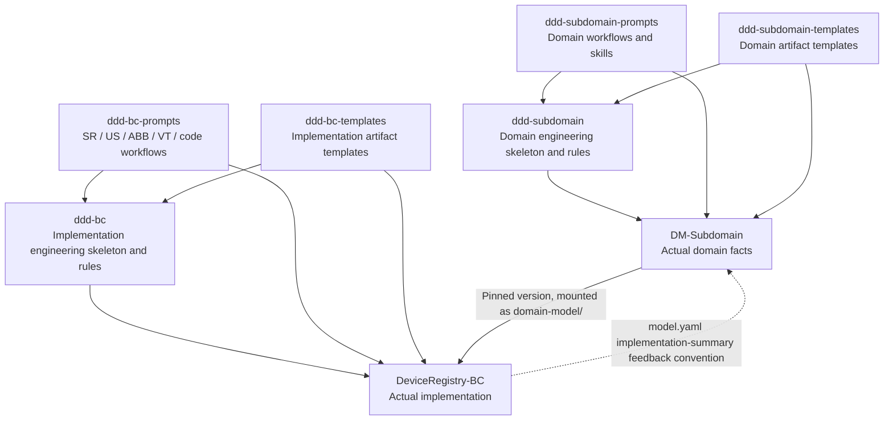

# Reference repository research notes

This document keeps the research observations from 2026-10-12 and interprets their design implications in light of the repo-template direction adopted on 2026-10-13. All repositories are reference projects only: they are not this project's code base, objects to retrofit, or default dependencies, and nothing below is a task list for fixing these repositories or building our own executor.

## 1. Overall assessment

This system is an **engineering framework driven by domain facts, with V-model traceability and workflow-level AI assistance**, not a simple CRUD scaffold. It already answers "where business facts come from", "who maintains which artifact", and "how to derive the implementation from the domain".

The earlier research, which targeted a hosted executor, concluded that most development rules still need Agent and human interpretation, and that the repository files alone cannot prove that an enforceable hosted closed loop already exists. Now that the product has become a repo template, this observation mainly reminds us to distinguish "working conventions" from "actual platform capabilities"; it does not require us to build an execution engine.

This assessment does not dismiss the existing tools: upstream already has an artifact validator, a Git hook, a fan-out pipeline, and an execution-engine roadmap. Assess "existing partial automation" and "end-to-end hosting already in place" separately. For versions and evidence, see the [source register](source-register.md).

## 2. How the eight repositories relate



In the diagram, "skeleton → instance" denotes a structural and workflow relationship; it does not mean this round verified the full Git ancestry. The prompts/templates versions that are consumed are also not necessarily the upstream HEAD.

### Three kinds of responsibility are kept separate

| Layer | Role | Value |
|---|---|---|
| Framework engineering | Directories, guides, scope rules, tools, onboarding conventions | Gives humans and agents a stable place to work |
| Prompts / skills | Activities such as domain interviews, artifact derivation, reviews, and impact analysis | Turns activities into workflows with inputs and outputs, rather than vague roles |
| Templates | Artifact fields, statuses, references, and content structure | Makes results comparable, indexable, and checkable |

This separation of responsibilities is worth borrowing. As the user chose, the directory names of our own skeleton follow this engineering set and use names such as `domain-model`, `software-requirements`, `user-stories`, `architecture`, `verification`, and `_templates`; we do not inherit the six physical dependency repositories. Project materials, working rules, and Agent capability files are maintained in one template that uses explicit links to avoid duplicated content, without a separate package-management or runtime system.

In our single-repository template, the domain-side stakeholder requirements are organized as the top-level `stakeholder-requirements`; this adopts their responsibility and terminology and does not mean the original repositories place them at the same level. `logs` and the development guide are our own additions; for the full basis of adoption, see the [source register](source-register.md) and the [template blueprint](../design/repository-blueprint.md).

## 3. The business chain is already fairly complete

### Upper half of the V: first make sure the right problem is being solved

`DM-Subdomain` holds domain definitions, terminology, business rules, bounded contexts, capabilities, use cases, invariants, stakeholder requirements, and validation scenarios.

Key principles include:

- Domain knowledge comes from experts; unknowns go into `BL-NNN` and must not be filled in by an agent out of thin air.
- Business rules come before invariants; artifacts start as Draft, and confirmation and approval are human responsibilities.
- One subdomain corresponds to one domain repository with clear ownership; implementation code does not live there.
- `model.yaml` provides a machine-readable view for bridging across repositories.

### Lower half of the V: turn the settled intent into software and verify it

The main chain in `DeviceRegistry-BC` is:

```text
Domain REQ / UC / INV
  -> Software requirement SR
  -> Delivery slice US
  -> Architecture ABB and verification specification VT
  -> Implementation code and actual tests
```

ABB and VT can proceed in parallel once the US conditions are met, instead of forcing "the architecture agent must finish before work passes to the QA agent". This is exactly where workflows beat role-play.

### A real vertical sample

Read against the domain version `a187ce9c...` pinned by DeviceRegistry-BC:

| Step | Actual content | Evidence |
|---|---|---|
| REQ-001 | Common Device Onboarding, including business acceptance requirements for permissions, identity, and leaving no partial registration on failure | E11 |
| UC-DR-001 | Approved registration flow; OTP, portal enrollment, and similar items have separate open boundaries | E11 |
| SR-001 | Software registration requirement that references REQ, UC, and invariants | E10 |
| US-001 | Approved delivery slice that explicitly places OTP and Draft enrollment outside this scope | E10 |
| ABB-001 | Design of API, Domain, Persistence, Integration, and other parts, plus external dependencies | E10 |
| VT-002 | Integration verification specification covering persistence, the Identity stub, events, and Model creation | E10 |
| Code | `RegisterDeviceCommandHandler.cs` carries UC/SR/US/VT references and orchestrates the factory, persistence, and event publishing | E12 |
| Tests | `VT002_RegisterDeviceIntegrationTests.cs` contains actual API, PostgreSQL, and event assertions | E13 |

The directories and matrix show 18 SR, 15 US, and 22 VT documents, as well as unit/integration/e2e test projects. `net10.0` and C# 14 come from the actual project files, not from inference based on repository names.

**But having test files does not mean verification is complete.** This round did not run them and did not obtain trusted CI results for the corresponding commit.

## 4. Designs worth borrowing

| Existing strength | Candidate application in our own skeleton |
|---|---|
| Domain before code; unknowns recorded explicitly | Context distinguishes facts, assumptions, and proposals; open questions can block tasks |
| Workflow-level prompts rather than chained roles | Skills map to concrete activities and declare inputs, outputs, scope of changes, and completion conditions |
| Clear ownership of upstream and downstream repositories | Materials state ownership and read/write boundaries; single repository by default, with no report feedback channel built |
| Stable identifiers such as SR/US/VT and UC/INV | Adopt a namespaced, versioned reference mechanism; the core is not required to inherit every artifact type |
| DDD layering and inward dependency | Add dedicated rules when needed and verify them with the project's native checking tools |
| Intended Use / RC traceability | Treat as a product-specific documentation extension, keeping risk decisions human |
| `model.yaml` bridge and matrices | Borrow the practice of traceable sources; do not introduce a cross-repository bridge format in the first version |
| Change impact, onboarding, and backlog workflows | Extend from first generation into day-to-day maintenance, rather than a one-off scaffold |

## 5. Design constraints distilled from gaps in the references

The specific paths, artifacts, and behaviors below belong to the reference projects. The design requirements extract only the working conventions the current template needs; machine-enforced checks, permissions, and reviews are the responsibility of the project's existing tools and platform, and we do not promise that Markdown provides these capabilities automatically.

### 5.1 "Knowing the path" is not enough; the path must resolve deterministically

The `domainContextPath` in E02 is:

```text
subdomains/device-management/contexts/device-registry
```

But in E11, the real path inside the corresponding repository starts with `domain-model/subdomains/...`, and the BC mounts the whole domain repository at `domain-model/`. Under the joining rule of the existing prompt, two levels actually need to be distinguished:

```text
Mount root: domain-model/
In-repository path: domain-model/subdomains/device-management/contexts/device-registry/
```

In addition, R1's prompts/templates use relative submodule URLs; under URL resolution rules they would land in `Admin Center`, while the shared repositories that the user provided and that are currently readable are in `Center`. With the current identity, access to the former returns 404.

**Design requirement:** When external materials are genuinely needed, state their source, version, and actual path in the project description, and have the onboarding skill require a check that they exist. If they cannot be read, report it; do not guess paths, switch repositories automatically, or treat an empty directory as "no domain requirements". Do not build our own manifest and `doctor` for this.

### 5.2 The read-only boundary conflicts with bridge write-back

E03 specifies both of the following:

- do not modify `domain-model/`;
- update the `model.yaml` bridge sections in it after implementation milestones.

The same unconstrained write operation cannot satisfy both requirements.

**Design requirement:** Material boundaries must match the permitted operations. By default, do not write back to reference or external repositories; when a cross-repository change is actually needed, obtain separate authorization and use the existing Git/PR process. Do not give the implementing Agent arbitrary write access, and do not build a synchronization service for the template.

### 5.3 Status text is not proof of approval

The BC skill requires "always Draft", yet the US template starts at `Backlog` and has the statuses `Ready/Approved/In Progress/Done`; the bridge uses yet another capitalization and status set. Domain documents also keep table statuses alongside YAML summaries.

This does not necessarily mean any business decision is wrong, but it widens the room for an agent to interpret statuses on its own.

**Design requirement:** Express content status, task progress, and actual approval separately. `Status: Approved` does not mean an authorized person has approved; formal approval depends on the platform and manual process the project adopts, and the template does not authenticate identity on its own.

### 5.4 Current code generation is not hosted development

E04 explicitly leaves test implementation to developers and defines non-interactive mode as a pre-specified generation scope, not autonomous CI execution. Non-empty target files are skipped and the conflict is reported.

This is a reasonable boundary for assisted generation, but it cannot cover what we need here: day-to-day modifications, fixes, test writing, running verification, responding to reviews, and resuming across sessions.

**Design requirement:** Use a complete delivery task as the unit of work; within the approved scope, allow modifying existing code and implementing tests. Conflicts, tests that were not run, and unfinished TODOs must not be presented as success. Generating the initial template and ongoing development are two different kinds of operation.

### 5.5 Document traceability must reach acceptance criteria and run evidence

VT-002 in E10 still has empty `Test-Framework` and `Test-File` fields, while E13 already contains the corresponding test implementation. The request in the VT specification is `POST /systems`, whereas the actual test uses `v1/tenants/{TenantId}/systems`. The local AC numbers in the test file also do not mean exactly the same as the identically numbered ACs of US-001.

The traceability matrix also records "Implemented", Draft gaps, and partially pending items side by side. It is a useful working view, but it should not become unconditionally trusted proof of completion.

**Design requirement:** ACs use fully qualified identifiers such as `DeviceRegistry-BC/US-001#AC-3` and link to specific test identifiers and actual results. API contracts, test specifications, and test implementations need consistency checks, and reports are bound to the same commit and input versions.

### 5.6 Checkers exist, but the level of checking still needs to rise

The validator in E07 mainly checks required headings and some placeholders; it is not a full validator of the semantic graph, approvals, or run evidence. Its change detection tries different main/master branches and falls back to the index (staging area) on failure; in a hosted pipeline, a wrong baseline could therefore degrade into an empty check.

The commit hook checks for `reviewed-by:` text. That suits a local reminder, but it cannot authenticate the reviewer's identity and cannot replace server-side branch policies.

**Design requirement:** When using existing checking tools, state the baseline explicitly and keep the real results for anything unparseable, not run, or lacking evidence. The real approval and merge gates are whatever the hosting platform actually configures; the template does not gain enforcement just because it provides checking instructions, and local hooks are only early feedback.

### 5.7 Architecture rules need implementable precision

The table in E03 requires that Presentation depend only on Application; the API project in E14 also references Infrastructure for startup and dependency injection.

New rules should not simply forbid the whole API project from referencing Infrastructure, or a normal composition root would fail too; nor should they let every controller access the database freely.

**Design requirement:** Constrain the permitted startup composition point separately from business code, and express exceptions with project/assembly-level and symbol-level checks. Define boundaries without forcing reasonable implementations into workarounds that evade the rules.

### 5.8 The roadmap diverges from current governance, pending a decision

The accepted ADR in E05 chooses a human-approved workflow, and E15 likewise stresses not promoting statuses. The second half of E06, however, proposes:

- auto-approval when an Approved parent artifact lacks UC/INV stubs;
- auto-approval/merging once code tests pass.

This is a **planned change in governance direction**, not an accepted unified policy. An Approved parent requirement cannot automatically prove that a newly derived UC is correct, and passing tests cannot prove that the tests cover the right requirements.

**Design requirement:** With user authorization, existing Agents can create drafts and pull requests with fixes; actual approval remains with humans and the platform. The template itself triggers no external writes and does not enable auto-merge.

## 6. Upstream is already evolving toward AI-native

R6's `_roadmap/` uses the name Tantu and already plans:

- DDD terminology abstraction and profiles for different levels of complexity;
- a gap detector and impact-analysis triggers;
- `tantu init/check/migrate`;
- GitHub/GHE integration, graph generation, evaluation, and interaction logs;
- multi-model and cross-product governance.

These roadmaps show that some of the ideas have precedents, but they do not determine what we go on to build. Our own project is positioned as follows:

> Build our own R&D repo template and Agent capability files, and define our own material structure, R&D process, and verification records. Artifact-driven development, DDD/V-model, and similar approaches are methods to borrow from; we are not building a successor version of the existing framework, nor our own execution-contract runtime.

Whether existing source code and templates can be reused must first be confirmed by authorization; this round extracts only design ideas and behavioral requirements and does not port implementations directly.

## 7. Direct conclusions for the standalone repository

1. Provide a ready-to-use project template that lets existing Agents find requirements, carry out tasks, record real verification, and hand off.
2. Within the scope confirmed in P0, exercise the entry points, documentation workflow, and handoff in a standalone copy of the skeleton; creating a synthetic application is not required, and the reference repositories are neither connected nor modified.
3. Maintain document templates, instructions, agents, skills, and prompts together, without duplicating body text.
4. Do not introduce a home-grown CLI, scheduling system, or default auto-merge; leave actual execution and permissions to existing tools.
5. The template itself also works through explicit tasks, real checks, and readable records, rather than expecting only downstream projects to comply.
