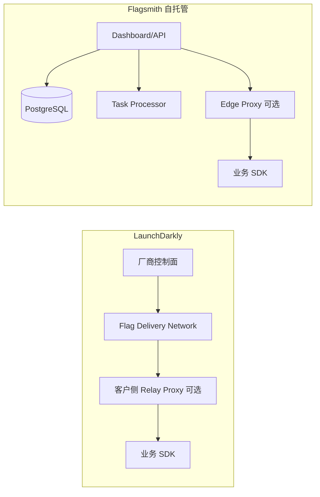
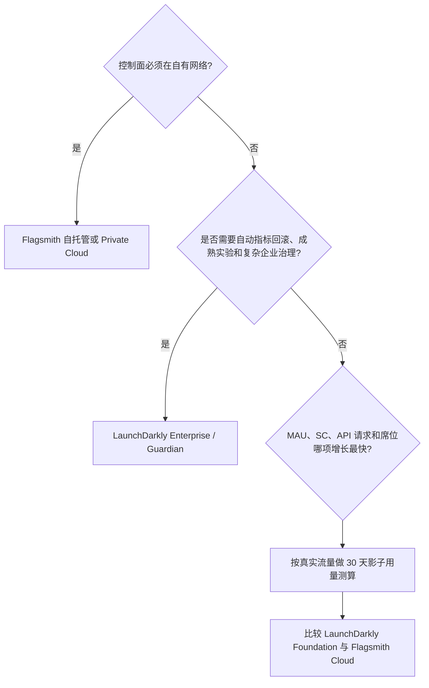

# LaunchDarkly 与 Flagsmith 深度对比

> 信息核对日期：2026-10-15  
> 结论适用范围：企业功能开关、远程配置、渐进式发布和实验平台选型  
> 价格币种：美元；公开价格会调整，采购前应以正式报价和合同为准

## 先给结论

两款产品解决的是同一类问题，但优化目标不同。

- **LaunchDarkly 更像完整的发布控制平台。** 它在复杂分群、实验、审批、发布自动化、自动回滚、代码引用、可观测性和企业集成上更成熟。控制面由厂商托管，团队省下了运行平台的工作，但要接受 SaaS、按连接数或 MAU 计费，以及较强的产品绑定。
- **Flagsmith 更像可掌控的开源功能开关平台。** 核心功能够用，云服务入门价格低，能部署到公有云、私有云、本地机房或隔离网络。代价也很直接：自托管并不是“免费版 LaunchDarkly”，数据库、高可用、升级、备份、安全修复和容量管理都由使用方承担。
- 如果目标是**把发布事故率、实验效率和跨团队治理做到最好**，且允许使用 SaaS，LaunchDarkly 通常更合适。
- 如果**数据主权、离线网络、源码可审计或退出能力**是硬约束，Flagsmith 胜出。若没有这些硬约束，优先比较 Flagsmith Cloud，而不是一开始就自托管。
- 对多数中小团队，真正有竞争力的组合是 **Flagsmith Cloud vs LaunchDarkly Foundation**；对强监管组织，则是 **Flagsmith 自托管/Private Cloud vs LaunchDarkly Enterprise/Federal/EU**。这两组不能混在同一张价格表里简单比月费。

## 1. 研究方法与边界

### 研究问题

在功能完整度、开发体验、部署方式、日常运维、可靠性、安全治理和三年总拥有成本几个方面，LaunchDarkly 与 Flagsmith 分别适合什么组织和工作负载？

### 检索范围

- 厂商官方产品文档、定价页、安全和 SLA 页面
- 官方 GitHub 仓库及发布记录
- OpenFeature 和 Terraform 生态页面
- 当前目录中的 Flagsmith Docker Compose 样例
- 检索截止到 2026-10-15；中文与英文资料均纳入，最终引用以英文原始页面为主

### 纳入和排除

纳入能说明当前产品行为、部署边界、计费单位和运维责任的第一方资料。厂商对比页、营销博客和没有方法说明的第三方排行榜只用于发现线索，不作为独立证据。公开页面没有给出具体价格、SLA 或功能层级时，报告标成“需询价/需合同确认”，不补猜测。

### 证据强度

| 证据类型 | 权重 | 用法 |
|---|---:|---|
| 官方技术文档、API 文档、公开定价 | 高 | 产品行为和公开商业条款的主要依据 |
| 官方开源仓库、许可证、发布记录 | 高 | 验证源码开放程度、活跃度和实际交付 |
| 官方安全/信任中心 | 中高 | 说明已公开的控制措施；证书范围仍要看审计报告 |
| 官方营销页 | 中 | 可说明产品定位，不能单独证明性能或可用性 |
| 本报告的成本和人力估算 | 中低 | 用于预算建模，不是厂商报价 |

## 2. 产品定位

| 项目 | LaunchDarkly | Flagsmith |
|---|---|---|
| 产品形态 | 商业 SaaS 平台；客户侧可运行 Relay Proxy 等组件 | 开源核心 + SaaS + 托管私有云 + 自托管 |
| 开源程度 | SDK、Relay Proxy、代码扫描器等开源；核心控制面不开源 | 核心平台仓库采用 BSD-3-Clause，平台和 SDK 可审计、可自行部署 |
| 主要优势 | 发布自动化、治理、实验、可观测性、集成深度 | 部署自主权、可退出性、低门槛价格、核心功能透明 |
| 主要短板 | 完整控制面不能通用自托管；规模化计费可能较高 | 高阶发布控制和实验成熟度落后；自托管把平台工程责任转给客户 |
| 最适合 | 多团队、强治理、追求发布效率和自动化的大中型组织 | 强数据主权、隔离网络、成本敏感或希望掌握源码的团队 |

## 3. 功能对比

### 3.1 功能开关与远程配置

两者都支持布尔和多变量开关、远程配置、按身份属性分群、指定用户覆盖、百分比灰度、多个项目和环境。对常规的“先给内部员工，再给 5%，随后全量”流程，两者都能完成。

LaunchDarkly 的差异主要出现在复杂发布中：

- 服务端 SDK 默认保持流式连接，配置变更会推送到 SDK。SDK 在本地内存中求值，业务请求不需要每次访问 LaunchDarkly。
- 有更完整的渐进发布、守护式发布、迁移开关、发布流水线、审批和发布健康管理。
- Guardian 附加项可监控指标，发现统计显著的回归后暂停或自动回滚。
- 代码引用、过期检查和 extinction event 能把开关清理纳入研发流程。

Flagsmith 的核心能力接近，但自动化闭环较短：

- 服务端既可远程求值，也可下载 environment document 后本地求值。本地求值默认每 60 秒刷新一次，变更传播速度取决于轮询设置。
- Edge Proxy 默认每 10 秒拉取环境文档，把远程求值流量收敛到客户网络边缘。上游不可用时，它能继续服务最近一次成功缓存。
- 支持定时开关、变更请求、审计日志、功能版本、依赖关系和代码引用/使用分析。
- 内建 Experimentation 仍是 Beta，Release Pipelines 是 closed beta，且官方文档明确说明流水线暂不自动回滚。
- 公开定价页在 2026-10-15 仍把 Data-Driven Releases 标为 “soon”。因此不能把它视为与 LaunchDarkly Guardian 等价的现成功能。

**判断：** 核心开关能力差距不大；复杂发布、风险监控和自动回滚的差距明显。

### 3.2 实验

LaunchDarkly Experimentation 支持 A/B/n、A/A、频率学和贝叶斯结果、多臂老虎机、跨前后端指标以及数据仓库指标。实验和开关、分群、发布、可观测数据处在同一产品里，适合需要连续实验的平台团队。

Flagsmith 支持 A/B 和多变量测试。内建 Experimentation 已有 exposure、conversion、Bayesian 结果和 sample-ratio mismatch 检查，但截至核对日期仍标为 Beta。新版本正在增强实验和外部仓库能力，不过自托管实验不是只打开一个配置项：官方 Helm 文档要求额外准备 Kafka 和 ClickHouse，默认 Kafka 复制因子对应至少 3 个 broker。实验基础设施未部署时，实验 UI 会隐藏。

这带来两个现实差异：

1. LaunchDarkly 的实验成本主要在订阅和事件数据；Flagsmith 自托管的成本落在 Kafka、ClickHouse、数据质量和运维人员。
2. 若团队只要固定比例分流并在现有 BI 中看结果，Flagsmith 已经够用。若需要统计方法、自动分配、仓库原生指标和统一分析，LaunchDarkly 更成熟。

### 3.3 治理与安全

两者都有 SSO、RBAC、审计日志和变更审批，但能力层级和套餐限制不同。

| 能力 | LaunchDarkly | Flagsmith |
|---|---|---|
| 自定义角色和团队 | Enterprise | Scale-Up/Enterprise，细到组织、项目、环境和标签 |
| SAML SSO | Enterprise | Scale-Up 页面列出 SAML；文档把 SAML 配置要求写为 Enterprise licence，需合同确认 |
| SCIM | Enterprise | 定价页标为 “soon”，采购前确认实际可用性 |
| 变更审批 | 工作流、审批、调度；可从 UI、API、Slack/Teams 处理 | Feature/Segment Change Request；创建、批准、发布权限分离 |
| 审计 | 平台审计和企业集成 | 所有管理操作有审计记录，可通过签名 Webhook 导出 |
| 强制四眼原则 | 支持 | 支持；功能状态与 Segment 可分别启用 |
| 数据驻留 | 美国、EU、Federal 等实例，功能存在区域差异 | SaaS 多区域、托管私有实例、客户自托管和 air-gapped |

LaunchDarkly 的企业治理更完整，特别是 SCIM、跨工具审批和发布自动化。Flagsmith 的权限模型本身并不简陋，但一些能力只在商业许可证中可用；“代码开源”不等于所有企业功能都无条件免费。

## 4. 研发体验

### 4.1 SDK、求值和故障行为

LaunchDarkly 公开定价页列出 30 个 SDK。服务端 SDK 启动时拉取配置，随后通过流式连接接收更新，并在本地内存中求值。连接中断后继续使用缓存；首次启动无法连接时，回退到应用代码提供的默认值。服务端还可以配置持久化数据存储，提高冷启动时的可用性。

Flagsmith 覆盖主流前端、移动端和服务端语言。服务端 SDK 可以：

- 远程求值：集成简单，但每次获取身份相关开关可能产生网络请求；
- 本地求值：周期拉取环境文档，在进程内求值；延迟低、吞吐高，但变更传播取决于刷新周期；
- 通过 Edge Proxy 求值：把客户端请求留在本地网络，由 Proxy 周期拉取上游配置。

Flagsmith SDK 提供默认 Flag Handler 作为求值失败时的回退。Edge Proxy 的 readiness 会检查缓存是否在允许的陈旧窗口内，也可配置成成功拉取一次后永不因陈旧而失败。这个选项提高了上游故障时的连续性，也可能让错误配置长期存活，必须配套监控最后更新时间。

### 4.2 工具链

| 研发面 | LaunchDarkly | Flagsmith |
|---|---|---|
| REST API | 完整 | 完整的 Management API 和 SDK API |
| CLI | 官方 CLI，覆盖常见管理任务 | API 优先，CLI 和 IDE 体验不如 LaunchDarkly 完整 |
| Terraform | 官方 provider，企业使用较多 | 有 provider；资源覆盖和升级兼容性应在 POC 中逐项核对 |
| IDE/AI 工具 | VS Code、IntelliJ、GitHub Copilot 扩展、MCP、Vega 等 | 以 Dashboard、API、SDK 和开源生态为主 |
| 代码引用 | 官方开源扫描器，多 CI/代码托管集成 | 有代码引用和 Flag Analytics；自动清理流程较轻 |
| OpenFeature | 官方生态目录可见 8 个条目，部分由社区维护 | 官方生态目录可见 10 个 vendor-supported provider |

OpenFeature 能减少业务代码对某家 SDK API 的直接依赖，但不能抹平产品差异。审批、实验、分群语法、事件模型和发布工作流仍然是厂商能力，而且两家的 provider 语言覆盖并不相同。较稳妥的做法是用 OpenFeature 包住“取值”接口，同时把管理面自动化限制在一层内部 adapter 中。

### 4.3 测试和本地开发

两边都可以在测试中 mock 或使用离线数据。LaunchDarkly 的优势是 SDK 模式统一、流式更新和工具链成熟；Flagsmith 的优势是可以把整套平台用 Docker 拉到开发机或测试环境中。

当前目录的 `docker-compose.yml` 适合 POC，不适合原样进生产：

- 数据库、Django Secret、允许主机和镜像标签都是演示配置；
- `latest` 镜像不能提供可重复部署；
- 单 PostgreSQL、单 API 实例没有高可用；
- 没有 TLS、备份、灾备、外部密钥管理和升级回滚方案。

## 5. 部署与网络

### 5.1 LaunchDarkly

LaunchDarkly 的核心控制面和配置分发网络由厂商运行。官方架构说明核心组件跨多个可用区，SDK 通过 CDN 和分布式服务接收配置。EU 实例位于 AWS Frankfurt，但官方文档也明确写明，Datadog 运维监控和 Fastly 边缘分发仍可能在美国区域运行。对严格的数据边界要求，不能只看“EU instance”四个字，需要做数据流审查。

客户可部署 Relay Proxy：

- 减少出站网络连接，把多个 SDK 的流量汇聚到本地代理；
- 支持隔离网络中的特定离线模式；
- 缓存配置并改善局部可用性。

Relay Proxy 不是完整自托管。管理控制面、主数据和厂商服务仍在 LaunchDarkly；官方计费文档也明确写明，Relay Proxy 不减少计费的 service connections，计费仍按连接到 Proxy 的 SDK 数计算。

### 5.2 Flagsmith Cloud、Private Cloud 和自托管

Flagsmith 提供四种实际形态：

1. 多租户 Cloud：厂商运维，入口成本最低；
2. 托管 Private Cloud：专用实例，可选云和区域；
3. 客户自托管：Docker、Kubernetes/Helm、OpenShift；
4. 隔离/air-gapped：需 Enterprise 商务和支持方案。

基础自托管组件包括 Dashboard/API、任务处理器和 PostgreSQL。生产部署通常还要加：

- 多副本 API 和任务处理器、Ingress/LB、TLS；
- 托管 PostgreSQL 或等价 HA 集群、连接池、备份和 PITR；
- 日志、指标、分布式追踪和告警；
- 密钥管理、镜像仓库、漏洞扫描、升级与回滚流水线；
- 若使用实验，再加 Kafka 和 ClickHouse。

官方 Helm 文档建议生产使用外部托管数据库；默认 chart 只有单副本，而且不设置资源 request/limit。文档给出的起点是每个 Pod 1 vCPU、2 GB RAM，但实际容量必须压测。



## 6. 运维、可靠性和支持

### 6.1 责任边界

| 工作 | LaunchDarkly SaaS | Flagsmith Cloud | Flagsmith 自托管 |
|---|---|---|---|
| 控制面升级 | 厂商 | 厂商 | 客户 |
| 数据库 HA/备份 | 厂商 | 厂商 | 客户 |
| 配置分发容量 | 厂商 | 厂商 | 客户，或 Edge Proxy 分担 |
| SDK 集成和默认值 | 客户 | 客户 | 客户 |
| 监控平台自身 | 厂商为主 | 厂商为主 | 客户 |
| 安全补丁/CVE | 厂商平台 + 客户 SDK | 厂商平台 + 客户 SDK | 客户平台、镜像、依赖和 SDK |
| 灾备演练 | 厂商按合同 | 厂商按合同 | 客户设计和执行 |

Flagsmith 已支持通过 OTLP 导出 traces 和结构化日志，可接入 Grafana Tempo、Jaeger、Datadog 等后端；也可接 Sentry，Compose 样例启用了 Prometheus。可观测性“能接”不等于运维方案已经完成，仍需定义 SLI、告警阈值和 runbook。Flagsmith 状态页的历史事故也能看到 task processor 堆积、environment document 序列化错误等故障，这些分别会影响变更传播、本地求值、Webhook 和审计处理，应纳入告警与演练。

LaunchDarkly 把平台运维隐藏在 SaaS 后面，SDK 断网仍可用缓存。它还把业务发布监控做成产品能力：Guardian 能监控守护指标并暂停或回滚。这是 Flagsmith 当前最难直接对标的部分。

### 6.2 典型故障模式

| 故障 | LaunchDarkly | Flagsmith |
|---|---|---|
| 控制面短时不可达 | 已初始化服务继续用内存缓存；冷启动可用持久化存储或代码默认值 | 本地求值继续用最近文档；Edge Proxy 继续用缓存；远程求值路径受影响 |
| 流式连接中断 | SDK 重连，可退到轮询；轮询不推荐 | 本地求值按周期拉取；Edge Proxy 是轮询模型 |
| 冷启动且上游不可达 | 回退到应用默认值，是否安全取决于默认设计 | 回退 Handler/本地持久化策略取决于 SDK；必须实测 |
| 数据库故障 | 厂商处理 | Cloud 由厂商处理；自托管由客户处理 |
| 错误规则全量发布 | 审批、预览、渐进发布、Guardian 可降低影响 | Change Request、版本和定时发布可降低影响；自动指标回滚能力较弱 |
| 客户侧代理缓存陈旧 | Relay Proxy 监控和刷新策略 | Edge Proxy 有 readiness 和陈旧窗口；配置不当会长期服务旧值 |

### 6.3 运维工作量估算

以下不是厂商报价，而是预算模型：

- Flagsmith Cloud 与 LaunchDarkly：平台侧通常约 0.05–0.2 FTE，主要用于治理、SDK 基线、成本监控和开关清理。
- Flagsmith 基础自托管：约 0.2–0.5 FTE，前提是组织已有成熟 Kubernetes、托管 PostgreSQL、统一监控和备份平台。
- 高可用、跨区域、air-gapped 或带实验栈的 Flagsmith：约 0.5–1.5 FTE。隔离网络中的镜像同步、漏洞修复和升级窗口会把人力推高。

如果组织没有现成平台能力，自托管往往比 SaaS 订阅贵。它的价值主要是控制权，不是自动省钱。

### 6.4 SLA 与合规边界

| 项目 | LaunchDarkly | Flagsmith |
|---|---|---|
| 公开可用性承诺 | 99.99%，仅适用于 Gold/Platinum 支持计划 | 99.95%，面向 Enterprise |
| 赔付申请 | 连续两个月未达标且在 5 天内申请 | 按月计算，需在 30 天内申请 |
| 支持首响 | Silver 为 1 个工作日；Gold outage 1 小时；Platinum outage 30 分钟 | 公开资料未给出同等粒度的严重级别首响表 |
| 自建组件 | Relay Proxy 的 HA、监控和升级由客户负责 | 自托管基础设施故障不能默认算入厂商 SaaS SLA |
| 公开合规证据 | SOC 2 Type II、ISO 27001、ISO 27701、FedRAMP Moderate/Federal 环境 | SOC 2 Type 2；HIPAA、FedRAMP 等适用范围需索取正式文件 |

SLA 数字不能脱离支持计划和赔付条件。安全认证也要核对证书版本、审计范围、产品实例和有效期，不能把 Trust Center 的一个标签外推到全部部署形态。

## 7. 公开价格与成本结构

### 7.1 2026-10-15 的公开价格快照

#### LaunchDarkly

| 套餐 | 公开价格/上限 | 主要限制 |
|---|---|---|
| Developer | $0 | 1 项目、3 环境、5 个 service connections、1,000 client-side MAU/月、100K Experimentation MAU；无限席位 |
| Foundation（月付） | $12/SC/月、$10/1,000 client-side MAU/月 | 5 个 SC included；无限项目和环境；无平台/席位费 |
| Foundation（年付折算） | $10/SC/月、$8.33/1,000 client-side MAU/月 | 按年预付；其他用量和附加产品另计 |
| Enterprise | 询价 | 高级分群、自定义角色、工作流/审批、发布自动化、SCIM、SLA |
| Guardian | Enterprise 付费附加项 | 发布监控、guardrail、自动暂停/回滚 |

公开页面中的 `$10` 与 `$8.33` 分别对应月付和年付折算。采购时仍应让报价写明承诺量、超量价和预付方式。

LaunchDarkly 服务端按 service connection 计费：一个服务端 SDK 实例连接一个环境并持续一个月，约为 1 SC。生产和预生产都计费；同一应用内多个 SDK/环境分别计算。Relay Proxy 不会减少计费连接数。

#### Flagsmith

| 套餐 | 月付 | 年付月均 | 主要限制 |
|---|---:|---:|---|
| Free | $0 | $0 | 50,000 请求/月、1 席位、1 项目 |
| Start-Up | $45 | $40 | 1,000,000 请求/月、3 席位、无限项目、定时开关、A/B/MVT |
| Scale-Up | $300 | $250 | 5,000,000+ 请求/月、5 席位；最多 20 席位；月付额外席位 $60/人，年付折算 $50/人 |
| Enterprise | 询价 | 询价 | Cloud/Private Cloud/Self-hosted、20+ 席位、隔离部署、企业 SLA、培训和实时支持 |

页面说明 Start-Up 的持续超量费为 $7/100,000 请求；另一处又写 additional calls 从 $50/million/month 起，两个口径冲突，Scale-Up 的公开超量价也不完整。Enterprise 按合同。计费请求包括 `/flags`、`/identities`、`/traits` 和 `/environment-document`。一次 SDK 初始化通常至少产生一次读取；服务端本地求值会按刷新周期继续拉环境文档。Enterprise self-hosted 页面称不设 API request limit，但席位、许可证和基础设施成本仍存在。

### 7.2 两种计费模型不能直接按“请求量”换算

LaunchDarkly 服务端价格主要随常驻 SDK 实例和环境数增长；Flagsmith Cloud 主要随 API 请求和席位增长。这导致同一系统在两家平台上的成本曲线可能相反。

#### 示例 A：前端产品，100,000 MAU，每人每月 5 次会话

- LaunchDarkly Foundation：粗算 `100 × $8.33 = $833/月`（年付单价；未含其他产品用量）。
- Flagsmith：如果每个会话初始化一次，约 500,000 读取/月，落在 Start-Up 的 1,000,000 请求内，公开价 $45/月；但团队超过 3 人或需要 SAML/治理时，要升 Scale-Up 或谈定制价。

这里 Flagsmith 价格明显低，但 LaunchDarkly 提供的发布控制、实验和治理也更多。不能只比较这两个数字。

#### 示例 B：后端 Kubernetes，100 个常驻 Pod，只连接 1 个环境

- LaunchDarkly：约 100 SC。按页面价格并扣除 5 个 included，粗算 `95 × $10 = $950/月`；年付单价可能更低，Kubernetes 还有未公开的特殊费率。
- Flagsmith 本地求值：若 100 个 SDK 每 60 秒拉一次环境文档，约 `100 × 43,200 = 4.32M` 请求/月，接近 Scale-Up 档。通过少量 Edge Proxy 汇聚上游请求，可以改变这个成本曲线，但会增加客户侧代理运维。

#### 示例 C：隔离网络

- LaunchDarkly Relay Proxy 有离线模式，但它不是完整控制面自托管，需与销售确认支持和更新流程。
- Flagsmith 可完整自托管或 air-gapped。软件订阅可能需要 Enterprise；数据库、集群、备份、监控、安全修复和升级仍计入 TCO。

### 7.3 三年 TCO 公式

```text
LaunchDarkly TCO
= SC/MAU/事件/附加项订阅
+ 企业支持或专业服务
+ 内部治理与 SDK 维护人力
+ 迁移和退出成本

Flagsmith Cloud TCO
= 请求量和席位订阅
+ 企业功能/支持
+ 内部治理与 SDK 维护人力

Flagsmith 自托管 TCO
= 商业许可证/支持
+ 计算、数据库、存储、流量、备份、日志
+ Kafka/ClickHouse（使用实验时）
+ 平台工程、安全修复、值班、升级和灾备人力
+ 停机和容量不足风险准备金
```

预算时至少做 12 个月用量回放。只拿当前流量乘单价容易漏掉预生产环境、自动扩缩 Pod、短生命周期任务、前端匿名身份、实验事件和日志保留。

## 8. 开源、锁定与退出

Flagsmith 主仓库在 2026-10-15 约有 6.6k stars、584 forks，采用 BSD-3-Clause，最近仍有连续提交和版本发布。活跃度足以证明项目在维护，但 stars 不能替代供应商财务、支持响应和长期路线图评估。仓库说明也明确区分了开放核心和商业能力：核心功能保持开源，高级治理和管理功能需要有效的 Enterprise 许可证。

LaunchDarkly 的 SDK 和若干边缘工具开源，业务接入代码可审查；核心控制面和高级功能是专有 SaaS。其锁定主要来自：

- 分群和上下文模型；
- 审批、实验、指标、发布流水线；
- 审计、集成和历史数据；
- 计费与组织模型。

Flagsmith 的退出风险更低，但仍不为零。它支持组织导出/导入和 LaunchDarkly importer，但组织导出不包含 users、audit logs、change requests、scheduled changes、groups/custom roles、SAML 等治理数据。企业功能许可证、数据库 schema、实验数据、身份模型和管理 API 仍然是迁移成本。

建议：

1. 业务代码用 OpenFeature 或内部接口隔离求值。
2. 开关 key、默认值和 owner 存在代码仓库或配置清单中。
3. 每季度导出项目、环境、规则、Segment 和审计配置。
4. 在合同中写明数据导出、删除时限、涨价保护、SLA 和终止协助。

Terraform 也反映了管理面成熟度差异：核对日期的 Registry 快照中，LaunchDarkly provider 可见约 36 个 resources/28 个 data sources，Flagsmith 约 7/5。这个数字不代表资源质量，但说明 LaunchDarkly 当前能纳入 IaC 的管理面更广。

## 9. 场景化选型

| 场景 | 建议 | 原因 |
|---|---|---|
| 多产品线、数十个研发团队、要求严格审批和自动回滚 | LaunchDarkly Enterprise + Guardian | 发布治理和事故闭环更完整 |
| 快速上线核心开关，团队小，预算敏感 | Flagsmith Start-Up/Scale-Up | 功能足够，公开价低 |
| 大型 B2C 前端、MAU 很高但每人会话少 | 重点压测并测算 Flagsmith | LaunchDarkly MAU 计费可能快速增长 |
| 大量 Kubernetes Pod、调用量不高 | 两家都要做用量建模 | LaunchDarkly 对 Pod/环境敏感；Flagsmith 对轮询和 API 请求敏感 |
| 必须本地部署或 air-gapped | Flagsmith Enterprise 自托管 | 完整平台可在客户网络运行 |
| 需要成熟实验、多臂老虎机、仓库指标 | LaunchDarkly | 实验产品成熟度高 |
| 已有强平台团队和统一 K8s/Postgres/OTel | Flagsmith 自托管更可行 | 边际运维成本较低 |
| 没有平台团队，只是想省订阅费 | 不建议自托管 | 人力和可靠性成本通常会反超 |

### 一张简化决策树



## 10. POC 与采购核对清单

不要用“能不能开关”作为 POC 结论。两家都会通过。建议验证：

| 类别 | 验收项 |
|---|---|
| 性能 | 本地求值 p99；SDK CPU/内存；100、1,000、10,000 个 flag 下的启动时间 |
| 传播 | Dashboard 变更到各区域 SDK 生效的 p50/p95/p99 |
| 故障 | 上游断网、冷启动、缓存损坏、密钥轮换、数据库主备切换 |
| 安全 | SSO/SCIM、最小权限、服务账号、审计导出、私有属性/PII |
| 治理 | 双人审批、定时发布、紧急回滚、过期清理、owner 和标签 |
| 实验 | 暴露事件丢失、指标延迟、样本一致性、数据仓库权限 |
| 运维 | 备份恢复、版本升级、回滚、容量扩展、状态页与支持升级路径 |
| 成本 | 用真实工作负载跑 30 天，核对 SC、MAU、API 请求和事件量 |
| 退出 | 导出全部规则后，在 OpenFeature 测试应用中切换 provider |

采购前要求两家书面回答：

- 目标区域、数据流和子处理方；
- SLA 口径、赔付上限和报障窗口；
- 高级功能分别属于哪个套餐或附加项；
- 超量行为、单价、封顶和提前告警；
- SSO、SCIM、审计保留、API 限额；
- 数据导出格式、合同终止后的删除和迁移支持；
- Flagsmith 自托管企业功能的许可证边界；
- LaunchDarkly 的 Kubernetes、serverless、Python/Ruby 特殊费率。

## 11. 最终建议

如果没有额外约束，我会按下面顺序做决策：

1. **先确认是否有控制面自托管或 air-gapped 的硬要求。** 有就直接把 LaunchDarkly 的通用 SaaS 方案排除，重点评估 Flagsmith Enterprise。
2. **没有硬性部署要求时，先比较 Flagsmith Cloud 和 LaunchDarkly Foundation。** 不要因为 Flagsmith 能自托管就主动承担数据库和平台运维。
3. **如果发布事故的业务损失高，优先 LaunchDarkly。** Guardian、发布自动化、实验和治理带来的事故减少，可能远高于订阅差价。
4. **如果成本、可退出性和部署主权优先，选 Flagsmith。** 前提是接受高阶发布能力的差距，或者愿意用现有监控、CI/CD 和审批系统补齐。

一句话版本：**LaunchDarkly 买的是成熟的发布控制和低平台运维；Flagsmith 买的是控制权、可退出性和更低的功能开关入门成本。**

## 12. 主要来源

### LaunchDarkly

1. [Pricing](https://launchdarkly.com/pricing/)
2. [LaunchDarkly architecture](https://launchdarkly.com/docs/home/getting-started/architecture)
3. [Service connections](https://launchdarkly.com/docs/home/account/service-connections)
4. [Relay Proxy](https://launchdarkly.com/docs/sdk/relay-proxy)
5. [Guarded rollouts](https://launchdarkly.com/docs/home/releases/guarded-rollouts)
6. [Experimentation](https://launchdarkly.com/docs/home/experimentation)
7. [Approval reviews](https://launchdarkly.com/docs/home/releases/approval-reviews)
8. [Code references](https://launchdarkly.com/docs/home/flags/code-references)
9. [EU instance](https://launchdarkly.com/docs/home/infrastructure/eu)
10. [Security](https://launchdarkly.com/security/)
11. [Support plans](https://launchdarkly.com/policies/support-plans/)
12. [Terraform Provider](https://registry.terraform.io/providers/launchdarkly/launchdarkly/latest/docs)

### Flagsmith

1. [Pricing](https://www.flagsmith.com/pricing)
2. [Flagsmith GitHub repository](https://github.com/Flagsmith/flagsmith)
3. [Docker deployment](https://docs.flagsmith.com/deployment-self-hosting/hosting-guides/docker)
4. [Kubernetes/OpenShift](https://docs.flagsmith.com/deployment-self-hosting/hosting-guides/kubernetes-openshift)
5. [SDK integration overview](https://docs.flagsmith.com/integrating-with-flagsmith/integration-overview)
6. [Server-side SDKs](https://docs.flagsmith.com/integrating-with-flagsmith/sdks/server-side)
7. [Edge Proxy](https://docs.flagsmith.com/deployment-self-hosting/edge-proxy)
8. [OpenTelemetry](https://docs.flagsmith.com/deployment-self-hosting/observability/opentelemetry)
9. [RBAC](https://docs.flagsmith.com/administration-and-security/access-control/rbac)
10. [Change Requests](https://docs.flagsmith.com/administration-and-security/governance-and-compliance/change-requests)
11. [Audit Logs](https://docs.flagsmith.com/administration-and-security/governance-and-compliance/audit-logs)
12. [SAML](https://docs.flagsmith.com/administration-and-security/access-control/saml)
13. [Experimentation](https://docs.flagsmith.com/experimentation/)
14. [Release Pipelines](https://docs.flagsmith.com/managing-flags/release-pipeline)
15. [Organisation import/export](https://docs.flagsmith.com/administration-and-security/data-management/organisations-import-export)
16. [Service Level Agreement](https://www.flagsmith.com/service-level-agreement)
17. [Terraform Provider](https://registry.terraform.io/providers/Flagsmith/flagsmith/latest/docs)

## 13. 已知不确定项

- 两家 Enterprise、私有云、air-gapped、Guardian、特殊计算架构价格均需询价。
- Flagsmith 定价页与 SAML 文档对套餐要求的表述不完全一致，必须以合同 entitlement 为准。
- Flagsmith 公开页的超量单价存在 `$50/million` 与 Start-Up `$70/million` 两个口径。
- LaunchDarkly EU 文档对 Experimentation 和 Billing 的可用性存在互相冲突的页面。
- Flagsmith SCIM 在定价页仍写 “soon”，但技术文档已有 Enterprise 实施流程，GA 和 entitlement 需书面确认。
- 安全认证、数据驻留和 SLA 的适用范围随产品实例与合同变化，本报告没有把厂商某一张证书外推到全部服务。
- 成本示例未包含税费、网络流量、专业服务和组织已有平台的分摊成本。
