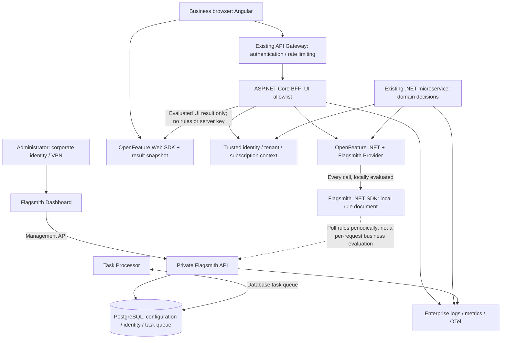
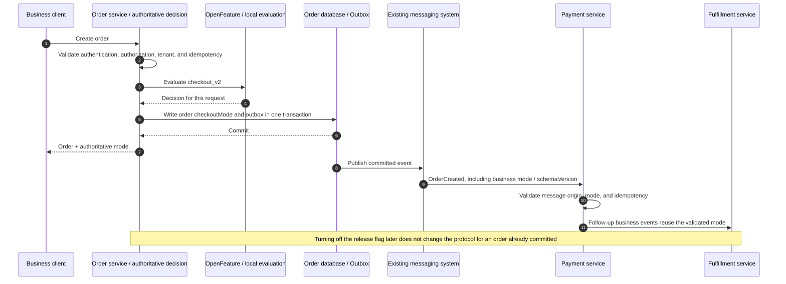
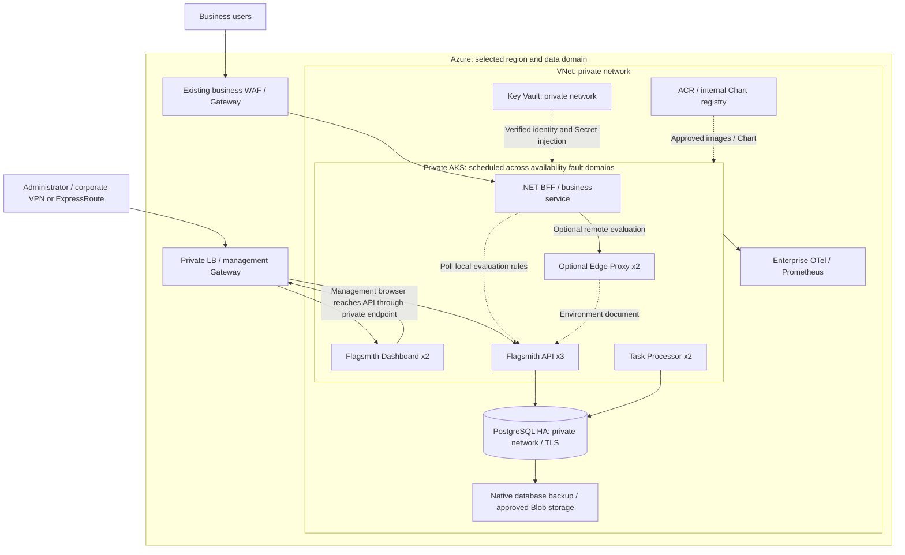
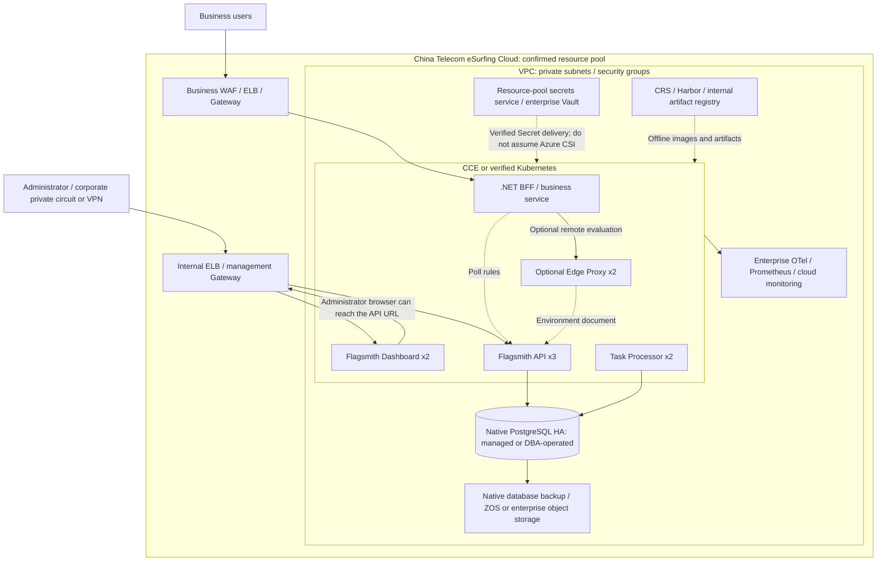
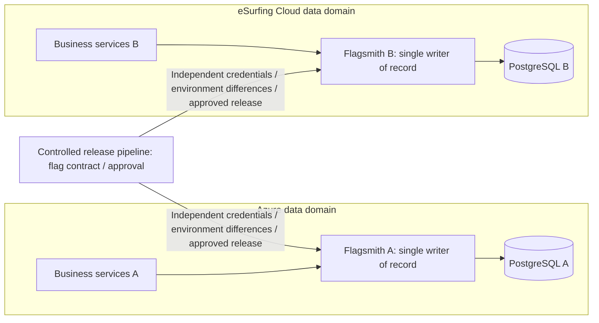

# Integration scenarios: architecture, sequence, and deployment diagrams

These Mermaid diagrams render in Markdown viewers that support Mermaid. Arrows represent rule distribution, business requests, or management writes. **Not every edge is on the hot path of one business request.** See the companion [Skill](../.github/skills/openfeature-flagsmith-dotnet/SKILL.md) and [deployment design](private-deployment.md).

## 1. Overall technical architecture

Default behavior: the server evaluates locally, and the enterprise front end obtains allowlisted results through a BFF. The Dashboard is the Flagsmith management front end, not the business web front end.



The logical diagram's OF and Local components each have their own instance in every .NET process. They are not one shared evaluation process for the company. The OpenFeature client and Provider are process-scoped; user context is scoped to the call.

## 2. Scenario A: the BFF controls the new checkout UI while the back end rechecks it

The UI and business logic can be rolled out gradually without treating the front-end display result as business authorization.

```mermaid
sequenceDiagram
    autonumber
    participant U as Browser
    participant W as OpenFeature Web / snapshot
    participant B as ASP.NET Core BFF
    participant I as Existing identity and tenant service
    participant O as OpenFeature .NET / Provider
    participant F as Flagsmith SDK local document
    participant S as Order service
    U->>B: GET /api/ui-features, existing session
    B->>I: Validate user, tenant relationship, and subscription version
    I-->>B: Trusted identity and traits
    B->>O: checkout_v2, default=false, invocation context
    O->>F: Local evaluation
    F-->>O: Value / error details
    O-->>B: Decision; observable error
    B-->>U: Allowlisted snapshot, contextVersion, expiresAt, degraded
    U->>W: Validate identity binding, schema, and TTL, then install snapshot
    W-->>U: Read Boolean synchronously and render the new or old UI
    U->>S: POST /orders, business input; do not accept the UI Boolean as a business decision
    S->>I: Independently validate authorization and tenant
    S->>O: Authoritative business evaluation, invocation context
    O->>F: Local evaluation
    F-->>S: Decision returned through OpenFeature
    S-->>U: Order and authoritative checkoutMode
    Note over U,S: The two requests may see different rules; the order service decides the business mode for this order
```

The BFF and order service may run in different processes, and their polling times may differ. If the two requests must never disagree, put the business decision and UI result in the same authoritative response, or bind the mode in the order or session domain. Do not pretend to have strong consistency by using a shorter cache.

## 3. Scenario B: a public UI connects directly through the official browser Provider

Use this only for public flags. The Edge Proxy is an optional evaluation layer. Environment documentation and server keys stay on the trusted network.

```mermaid
flowchart LR
    Browser["Public page"]
    Web["OpenFeature Web SDK"]
    Provider["FlagsmithClientProvider"]
    ClientSDK["Flagsmith JS SDK"]
    EdgeIngress["Restricted HTTPS endpoint: SDK paths / methods"]
    Proxy["Edge Proxy: remote evaluation"]
    Core["Private Core API"]
    DB[("PostgreSQL")]
    Browser --> Web --> Provider --> ClientSDK
    ClientSDK -->|"Client environment key; non-sensitive traits"| EdgeIngress
    EdgeIngress --> Proxy
    Proxy -.->|"Server key; poll environment document periodically"| Core
    Core --> DB
```



```mermaid
sequenceDiagram
    autonumber
    participant U as Business page
    participant O as OpenFeature Web
    participant P as Browser Provider / JS SDK
    participant E as Restricted evaluation endpoint / Edge Proxy
    participant C as Private Flagsmith API
    E->>C: Fetch document at startup, then update periodically
    C-->>E: Environment rules; never send them to the browser
    U->>O: setProviderAndWait, client key / initial context
    O->>P: Initialize
    P->>E: Fetch evaluation results for this identity
    E-->>P: Evaluated flags
    P-->>O: Ready
    U->>O: getBooleanDetails, default=false
    O-->>U: Synchronous result / default reason
    U->>O: When switching accounts, hide the old UI before await setContext
    O->>P: onContextChange
    P->>E: New identity and complete traits
    E-->>P: New result
    P-->>O: Ready / ConfigurationChanged
    O-->>U: Update the view
    Note over U,E: If the identity update fails, do not keep showing the previous user's result; client traits are not authorization
```

The initial request and explicit refresh are remote requests. `getBooleanDetails` reads the loaded result synchronously. SSE is not enabled in this diagram, so initialization does not automatically provide real-time refresh. See the [front-end reference](../.github/skills/openfeature-flagsmith-dotnet/references/frontend.md) for polling and SSE choices.

## 4. Scenario C: gradual rollout across microservices and consistency for asynchronous messages

When a new checkout protocol affects orders, payments, and fulfillment, do not let three independent, point-in-time flag results form an inconsistent transaction.



Messages do not trust a flag sent by the client. They express a business fact already accepted by the authoritative service. Emergency risk and security controls that must stop execution still run independently and take priority over the release mode.

## 5. Scenario D: control-plane failure, stale rules, and cold start

```mermaid
sequenceDiagram
    autonumber
    participant R as Running .NET service
    participant S as SDK local document
    participant C as Private Flagsmith API
    participant M as Monitoring / staleness policy
    participant N as Newly started business Pod
    R->>C: Normal poll
    C-->>S: Valid rule document
    R->>S: Local evaluation
    S-->>R: Normal value
    R->>C: Next poll
    C--xR: Network / control-plane failure
    R->>M: Refresh failure and last successful time
    R->>S: Still within the approved stale-document window
    S-->>R: Last-known-good
    alt Document exceeds the allowed stale window
        R->>M: Alert and apply the domain degradation policy
        R->>R: Return ordinary new features to the legacy path; keep independent security protections active
    end
    N->>C: Cold-start warm-up; no in-memory document
    C--xN: Unavailable
    alt No verified offline snapshot
        N->>N: Fail startup and do not receive traffic
    else Valid, environment-bound trusted offline snapshot configured
        N->>N: Validate integrity and expiry, then start under the offline policy
    end
```

Staleness monitoring and business degradation are operational and application capabilities that must be implemented. The diagram does not claim that an official contrib Provider supplies them automatically. Do not make liveness depend on the control plane and restart a process in bulk when its cached rules would otherwise let it continue serving.

## 6. Azure private deployment

The default is the BFF pattern with no public Flagsmith SDK endpoint. Optional components are labeled as such; the diagram does not claim that they have been deployed.



The exact private connectivity model for the database and Key Vault depends on the selected product configuration. A private AKS API does not make the application endpoint private. A public business Gateway may expose only the business BFF while the management endpoint remains on a private circuit.

## 7. China Telecom eSurfing Cloud private deployment



Confirm product capabilities, availability zones, SLA, and storage or load-balancer plugins for the target resource pool. PostgreSQL HA in this diagram is a deployment requirement. It is not a claim that every eSurfing Cloud resource pool provides the capability automatically.

## 8. Relationship between the clouds: independent control planes, no cross-cloud dual writes



The diagram does not show a database replication edge between the clouds because the baseline **does not share identity or business data and does not provide automatic cross-cloud failover**. If the business later requires one environment with cross-cloud primary and standby sites, add data-compliance, identity and bucket-retention, RPO and RTO, fencing, and failover-drill designs.
